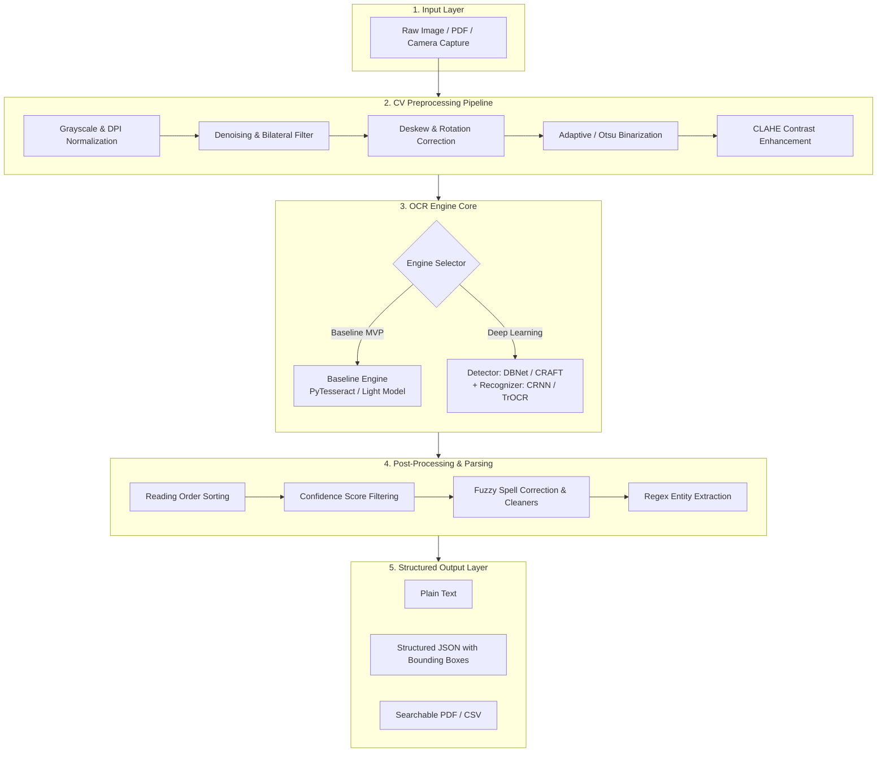
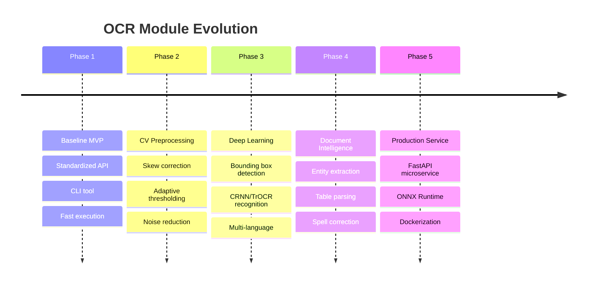

# 🔍 OCR Module (Optical Character Recognition)

An extensible, modular, and high-performance Python framework for **Optical Character Recognition (OCR)** and **Document Information Extraction**. Designed with an **iterative upgrade path**—starting from a lightweight, zero-overhead baseline model and progressively scaling into deep learning text detection and transformer-based recognition.

---

## 📌 Table of Contents
- [Overview](#overview)
- [System Architecture](#system-architecture)
- [Iterative Roadmap](#iterative-roadmap)
- [Project Structure](#project-structure)
- [Getting Started](#getting-started)
  - [Prerequisites](#prerequisites)
  - [Installation](#installation)
- [Quickstart & Usage](#quickstart--usage)
  - [1. Python API](#1-python-api)
  - [2. Command-Line Interface (CLI)](#2-command-line-interface-cli)
- [Preprocessing Pipeline](#preprocessing-pipeline)
- [Output Format](#output-format)
- [Future Enhancements](#future-enhancements)
- [License](#license)

---

## 📖 Overview

The **OCR Module** provides an end-to-end computer vision and NLP pipeline for converting scanned images, receipts, documents, and real-world scenes into clean, searchable, and structured machine-readable text.

### Key Highlights:
- **Modular Engine Abstraction**: Seamlessly switch between different OCR engines (`Baseline / Tesseract`, `EasyOCR / CRNN`, `TrOCR / PaddleOCR`) using a unified API.
- **Smart Preprocessing Engine**: Built-in computer vision algorithms for noise cancellation, contrast enhancement (CLAHE), adaptive binarization, and automated deskewing.
- **Spatial & Confidence Awareness**: Preserves bounding boxes, confidence scores, and reading order (top-to-bottom, left-to-right).
- **Post-Processing & Cleaners**: Regular expression extractors, error correction (Levenshtein / fuzzy dictionary matching), and structured JSON output.

---

## 🏗️ System Architecture



---

## 🚀 Iterative Roadmap

We follow an **iterative delivery model**, ensuring early functional baseline deliverables while systematically scaling capabilities:



1. **Phase 1: Baseline MVP (Current Focus)**
   - Minimal viable OCR engine with clean wrapper interface.
   - Core dataclasses: `BoundingBox`, `OCRWord`, `OCRResult`.
   - CLI utility for rapid testing on sample images.
2. **Phase 2: Computer Vision Preprocessing**
   - OpenCV-based enhancement: automated skew estimation, Otsu/adaptive thresholding, noise removal.
   - Diagnostic visualizer for inspected preprocessing steps.
3. **Phase 3: Deep Learning Engine Upgrade**
   - Multi-stage pipeline: Text detection (CRAFT/DBNet) + Recognition (CRNN/CTC or Vision-Transformers).
   - High accuracy on complex backgrounds, irregular orientations, and natural scene text.
4. **Phase 4: Structured Information Extraction**
   - Heuristic reading-order reconstructor.
   - Named entity extraction (dates, monetary amounts, invoice numbers, key-value pairs).
5. **Phase 5: Production & Microservices**
   - Async REST API with FastAPI.
   - ONNX Runtime and TensorRT acceleration.
   - Multi-stage Docker deployment.

> 📋 *For the comprehensive technical specification and milestone checklists, view the [Implementation Plan](file:///C:/Users/YashB/.gemini/antigravity-ide/brain/8d6eb2dd-60a1-4846-88fc-f405109a76ca/ocr_implementation_plan.md).*

---

## 📁 Project Structure

```text
OCR_Module/
├── data/
│   └── samples/                 # Sample images, receipts, and documents
├── src/
│   └── ocr_module/
│       ├── __init__.py          # Package initialization
│       ├── config.py            # Global settings & dataclasses
│       ├── pipeline.py          # Unified OCR pipeline coordinator
│       ├── core/
│       │   ├── __init__.py
│       │   ├── base.py          # Abstract BaseOCREngine class
│       │   └── types.py         # Standardized result data models
│       ├── engines/
│       │   ├── __init__.py
│       │   ├── factory.py       # Engine factory (swappable architectures)
│       │   └── baseline.py      # Baseline OCR engine implementation
│       ├── preprocessing/
│       │   ├── __init__.py
│       │   ├── deskew.py        # Skew correction
│       │   ├── filters.py       # Denoising and contrast filters
│       │   └── binarization.py  # Adaptive & Otsu thresholding
│       ├── postprocessing/
│       │   ├── __init__.py
│       │   ├── cleaners.py      # String cleanup & regex extractors
│       │   └── layout.py        # Reading order & box clustering
│       └── cli.py               # Command-line interface
├── tests/
│   ├── test_baseline.py         # Unit tests for baseline engine
│   └── test_preprocessing.py    # Unit tests for image processing
├── .gitignore                   # Ignored files (models, cache, venv)
├── LICENSE                      # Project license
├── Readme.md                    # Project documentation
└── requirements.txt             # Python dependencies
```

---

## ⚙️ Getting Started

### Prerequisites
- **Python 3.10+** (Python 3.11, 3.12, 3.13 supported)
- *Optional for Baseline Engine:* [Tesseract-OCR](https://github.com/tesseract-ocr/tesseract) installed on your system PATH.

### Installation

1. **Clone the repository:**
   ```bash
   git clone https://github.com/SpyHecker/OCR_Module.git
   cd OCR_Module
   ```

2. **Create and activate a virtual environment:**
   ```bash
   # Windows (PowerShell)
   python -m venv .venv
   .\.venv\Scripts\Activate.ps1

   # Linux / macOS
   python3 -m venv .venv
   source .venv/bin/activate
   ```

3. **Install dependencies:**
   ```bash
   pip install -r requirements.txt
   ```

---

## 💻 Quickstart & Usage

### 1. Python API

```python
from ocr_module.pipeline import OCRPipeline

# Initialize the pipeline (uses the baseline engine by default)
pipeline = OCRPipeline(engine_type="baseline", enable_preprocessing=True)

# Run OCR on an image
result = pipeline.process("data/samples/sample_receipt.png")

# Access full extracted text
print("--- Extracted Text ---")
print(result.text)

# Inspect individual words with confidence and bounding boxes
for word in result.words:
    print(f"Word: {word.text:<15} Confidence: {word.confidence:.2f}% Box: {word.box}")
```

### 2. Command-Line Interface (CLI)

Run OCR directly from your terminal:

```bash
# Basic text extraction
python -m ocr_module.cli --input data/samples/sample_invoice.png

# Output structured JSON with bounding boxes
python -m ocr_module.cli --input document.png --output-format json --out-file result.json

# Run with deskewing and adaptive preprocessing enabled
python -m ocr_module.cli --input noisy_doc.jpg --preprocess --visualize
```

---

## 🎨 Preprocessing Pipeline

Real-world images frequently suffer from poor contrast, camera tilt, and sensor noise. Our preprocessing module standardizes images prior to character recognition:

| Processing Step | Functionality | Primary Benefit |
| :--- | :--- | :--- |
| **Rescaling & DPI Normalization** | Resizes images to ~300 DPI | Optimizes stroke width for OCR kernels |
| **Bilateral Filter** | Noise reduction while preserving edges | Eliminates grain without blurring text strokes |
| **Deskew Algorithm** | MinAreaRect / Hough Transform angle detection | Aligns text lines horizontally |
| **Adaptive Binarization** | Local mean / Gaussian thresholding | Handles uneven lighting and shadows |
| **CLAHE** | Local histogram equalization | Recovers faint text from dark backgrounds |

---

## 📊 Output Format

The module outputs structured data following the `OCRResult` schema:

```json
{
  "engine": "baseline",
  "processing_time_ms": 142.5,
  "text": "INVOICE #1024\nTotal: $250.00",
  "words": [
    {
      "text": "INVOICE",
      "confidence": 98.4,
      "box": { "x": 45, "y": 120, "w": 110, "h": 28 }
    },
    {
      "text": "#1024",
      "confidence": 96.1,
      "box": { "x": 160, "y": 120, "w": 75, "h": 28 }
    }
  ],
  "metadata": {
    "image_dimensions": [1080, 1920],
    "skew_angle_corrected": -2.3
  }
}
```

---

## 🔮 Future Enhancements
- [ ] Integration of Vision-Transformer based recognizers (**TrOCR** / **Donut**).
- [ ] Key-Value pair extraction using spatial graph networks.
- [ ] Automated tabular data detection and CSV export.
- [ ] ONNX runtime export for low-latency CPU deployment.
- [ ] Dockerized microservice with OpenAPI/Swagger documentation.

---

## 📄 License

This project is licensed under the terms described in the [LICENSE](file:///e:/Github%20.git/OCR_Module/LICENSE) file.
